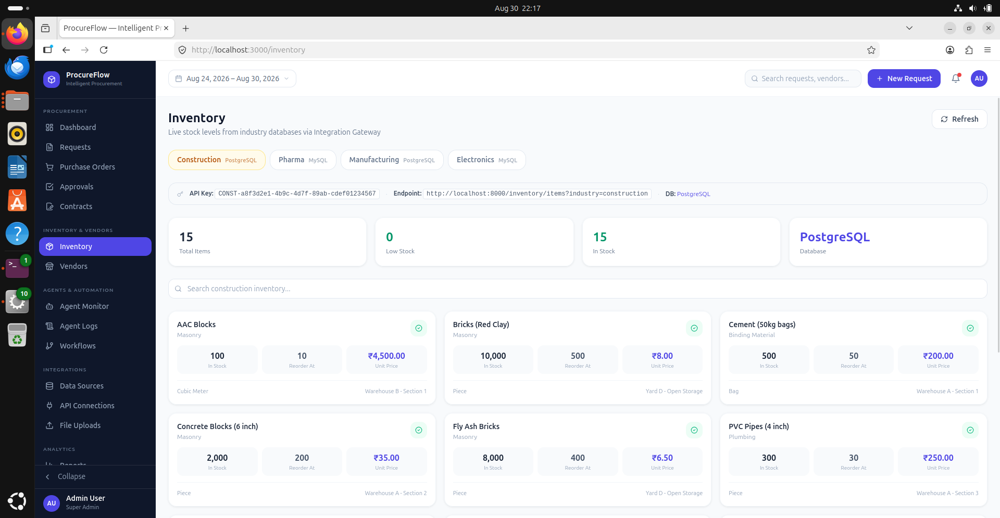
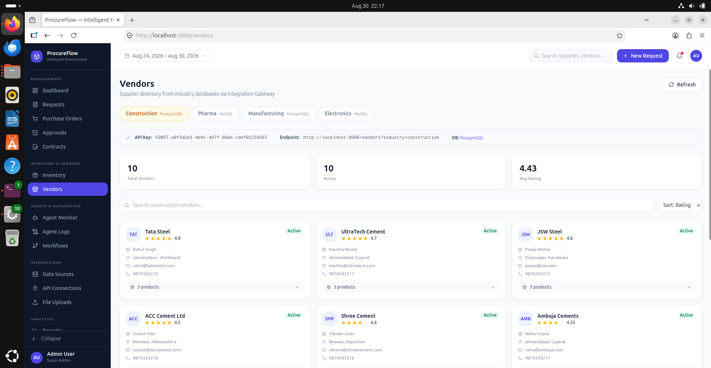
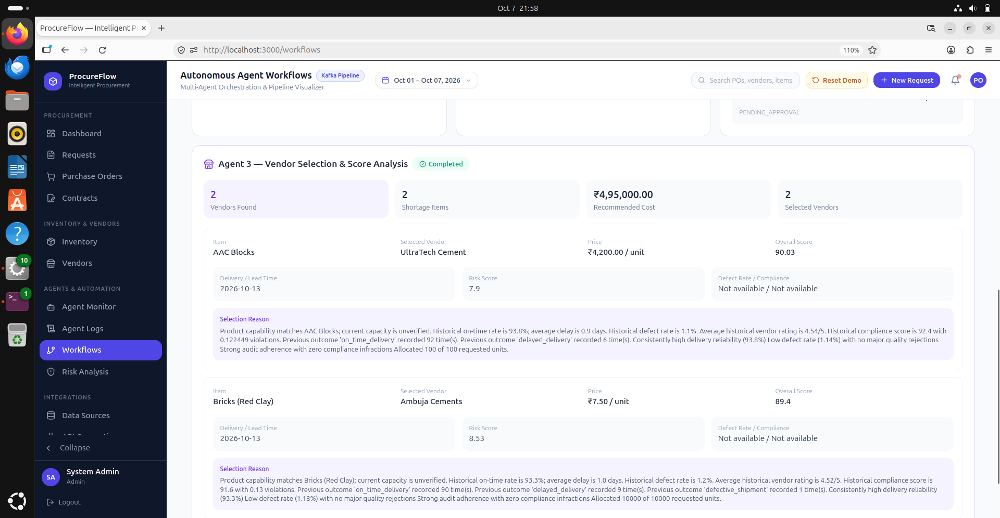
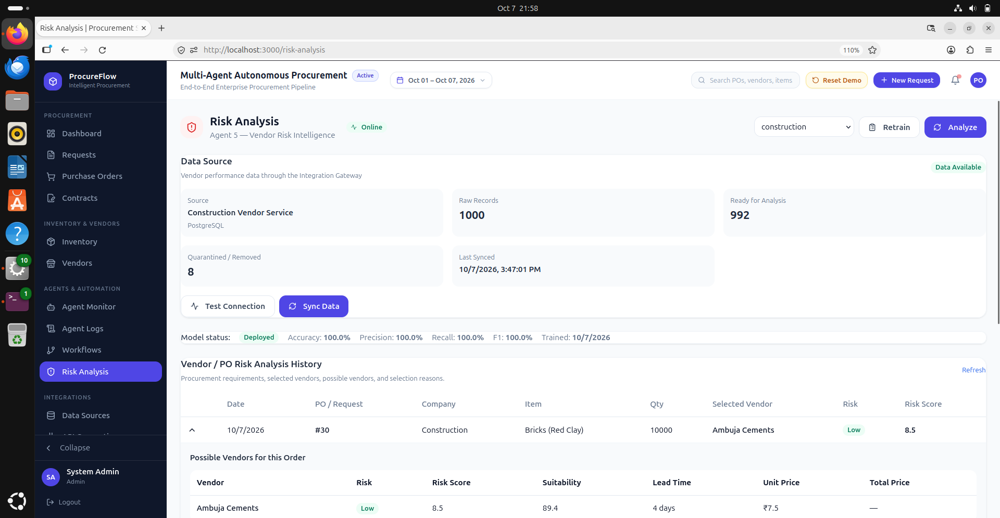
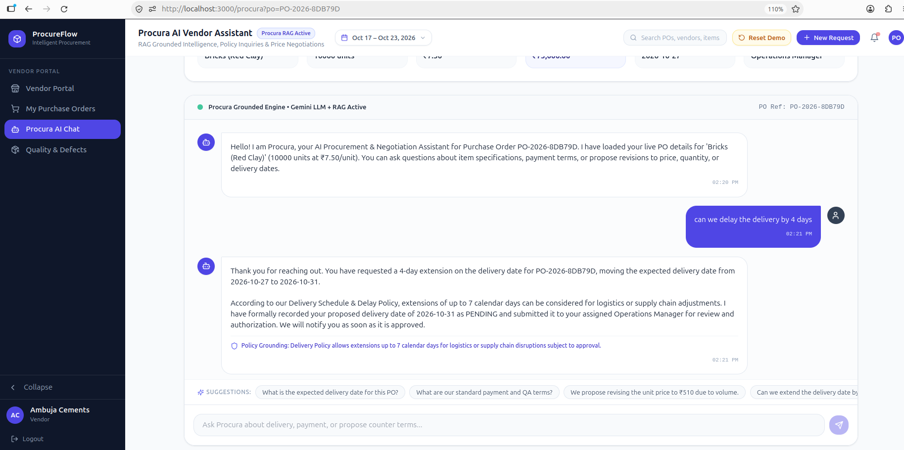
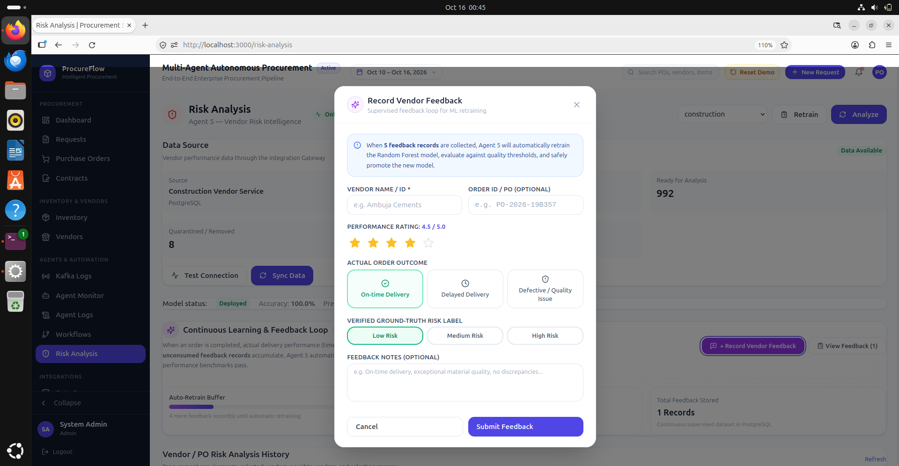
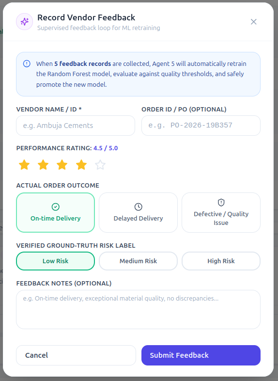

# Specialized Agent Specifications

Detailed documentation of each AI agent operating within the ProcureFlow ecosystem, including prompts, toolkits, inputs, outputs, and interface screenshots.

---

## 1. Document Intelligence Agent

- **Role:** Extracts unstructured text and tabular line items from invoices, bills of materials (BOM), and receipts.
- **Tools:** Tesseract OCR, PyMuPDF, Vision LLM parsing, Pydantic Schema Validator.
- **Input:** Raw PDF or image file uploaded to MinIO.
- **Output:** Structured JSON schema with normalized items, unit prices, taxes, and confidence scores.

---

## 2. Inventory Analysis Agent

- **Role:** Evaluates material requests against live multi-warehouse stocks to detect deficits and calculate required procurement quantities.
- **Tools:** PostgreSQL Read Connector, Safety Stock Evaluator, Reorder Point (ROP) Calculator.
- **Input:** List of required line items with quantities.
- **Output:** Net shortage report with urgency rating (Critical, High, Medium, Low).

{: .doc-image }

---

## 3. Vendor Evaluation Agent

- **Role:** Computes multi-attribute weighted rankings for all vendors capable of supplying the identified shortages.
- **Scoring Formula:**
  $$\text{Score} = (w_p \cdot \text{PriceScore}) + (w_d \cdot \text{DeliveryScore}) + (w_q \cdot \text{QualityScore}) + (w_c \cdot \text{ComplianceScore})$$
- **Tools:** Historical Performance Query Tool, Catalog Pricing Lookup.
- **Input:** Part numbers, deficit quantities, delivery deadline.
- **Output:** Ranked vendor shortlist with pricing, lead times, and rationales.

### Vendor Catalog Master
{: .doc-image }

### Vendor Selection Matrix
{: .doc-image }

---

## 4. Risk Assessment Agent

- **Role:** Evaluates supply chain risks, supplier dependency concentrations, price volatility, and geopolitical factors before committing purchase orders.
- **Tools:** Volatility Index Estimator, Single-Source Dependency Detector, Lead-Time Variance Calculator.
- **Input:** Top-ranked vendor profiles and order valuation.
- **Output:** Composite Risk Index (Low, Medium, High) with mitigation suggestions.

{: .doc-image }

---

## 5. Approval Coordinator Agent

- **Role:** Enforces corporate financial delegation rules, routes orders to authorized managers, and manages the DocuSign signature lifecycle.
- **Tools:** Role-Based Access Control (RBAC) Verifier, DocuSign eSignature API Client, Email Notification Dispatcher.
- **Input:** Purchase order draft, composite risk score, approver identity.
- **Output:** Signed legal contract, audit timestamp, and state transition to `PO_EXECUTED`.

---

## 6. RAG Vendor Chatbot Agent

- **Role:** Provides 24/7 conversational support for suppliers regarding order status, delivery timelines, payment terms, and automated RFP queries.
- **Architecture:** Retrieval-Augmented Generation (RAG) using FAISS vector store over purchase orders and vendor contract documents.
- **Tools:** Vector Search Tool, PO Status Query Tool, FAQ Knowledge Retrieval.

{: .doc-image }

---

## 7. Continuous Feedback & System Learning

ProcureFlow implements a continuous learning loop where procurement managers can submit feedback on agent recommendations:

{: .doc-image }
{: .doc-image }

Feedback scores are stored and used to adjust vendor ranking weights and risk sensitivities dynamically.
