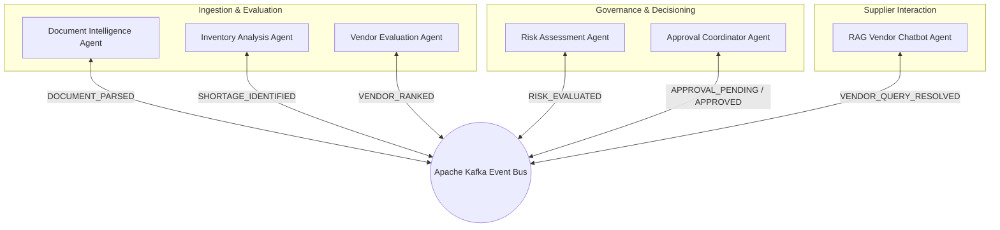

# Multi-Agent Orchestration & System Intelligence

ProcureFlow replaces rigid monoliths with a **multi-agent collaborative intelligence framework**. Rather than relying on a single prompt or monolithic script, specialized agents work cooperatively to solve complex procurement problems.

---

## 🤖 Agent Ecosystem Topology

---

## 💡 Key Architectural Principles of the Agents

### 1. Separation of Concerns
Each agent possesses dedicated system instructions, toolkits, and schemas. For instance, the **Inventory Agent** has SQL read tools for warehouse schemas, while the **Risk Assessment Agent** utilizes mathematical variance estimators and market indices.

### 2. Event-Driven Asynchrony
Agents communicate via **Apache Kafka topics**:
- `procureflow.document.ingested`
- `procureflow.inventory.shortage`
- `procureflow.vendor.scored`
- `procureflow.risk.evaluated`
- `procureflow.approval.status`

This event-driven model guarantees that if one agent encounters a network delay (e.g. external supplier API latency), downstream tasks do not freeze, and state transitions remain resilient.

### 3. State Management & Ephemeral Memory
Active agent sessions and multi-step reasoning traces are stored in **Redis**. This allows agents to recall previous turns during negotiation, maintain context across large documents, and support idempotency.

### 4. Human-in-the-Loop Safeguards
AI agents produce **recommendations**, not unilateral commitments. All financial commitments and legal dispatches require human sign-off via the Approval Hub.
