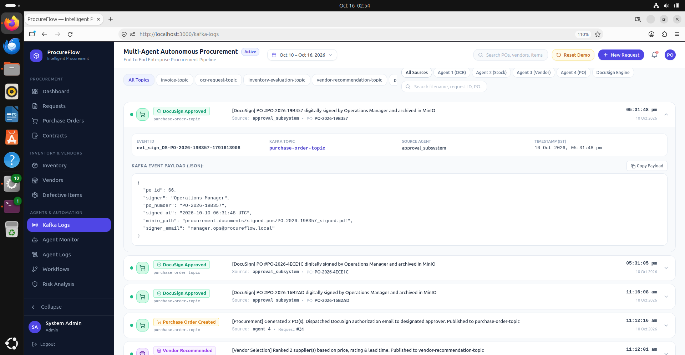
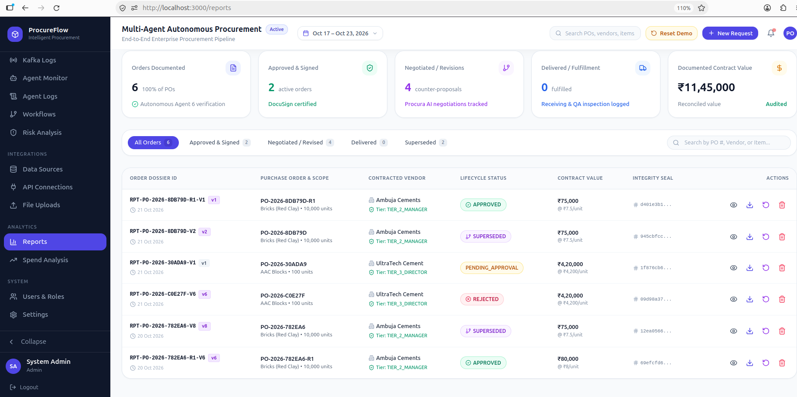

# REST API Specifications

ProcureFlow exposes a modular, OpenAPI-compliant RESTful API built with **FastAPI**. Every endpoint includes automated JSON Schema validation via Pydantic and interactive Swagger UI documentation at `/docs`.

---

## 🚀 Endpoint Directory

| Method | Endpoint | Description | Auth Required |
| :--- | :--- | :--- | :--- |
| `POST` | `/api/documents/upload` | Upload PDF/image invoice or BOM for OCR extraction | Bearer Token |
| `GET` | `/api/inventory/status` | Retrieve current stock levels across all warehouse depots | Bearer Token |
| `POST` | `/api/inventory/check-shortage` | Evaluate raw materials list for inventory shortages | Bearer Token |
| `GET` | `/api/vendors` | List registered manufacturing suppliers and ratings | Bearer Token |
| `POST` | `/api/vendors/evaluate` | Trigger Multi-Attribute scoring for deficit items | Bearer Token |
| `POST` | `/api/risk/evaluate` | Calculate risk indices for candidate vendors | Bearer Token |
| `POST` | `/api/orders/generate` | Generate draft purchase order from agent shortlist | Bearer Token |
| `POST` | `/api/orders/{id}/approve` | Record managerial approval and sign PO | Role: Approver |
| `POST` | `/api/signatures/docusign/envelope` | Create DocuSign digital signature envelope | Role: Approver |
| `POST` | `/api/chat/query` | Conversational RAG query for vendor inquiries | Public / API Key |
| `GET` | `/api/logs/kafka` | Stream live audit logs and agent event records | Role: Admin |
| `GET` | `/api/reports/generate-pdf` | Compile end-to-end PDF audit and procurement report | Bearer Token |

---

## 📡 Sample Request & Response Schemas

### 1. Document Upload & Line-Item Extraction
```http
POST /api/documents/upload HTTP/1.1
Content-Type: multipart/form-data

file: invoice_steel_fasteners_2026.pdf
document_type: invoice
```

#### Response (`200 OK`)
```json
{
  "status": "success",
  "document_id": "doc_9a8b7c6d-e5f4",
  "metadata": {
    "filename": "invoice_steel_fasteners_2026.pdf",
    "pages": 1,
    "confidence_average": 0.96
  },
  "extracted_data": {
    "vendor_name": "Apex Precision Metal Works",
    "invoice_number": "INV-2026-8941",
    "total_amount": 14250.00,
    "line_items": [
      {
        "part_number": "M12-BOLT-HEX",
        "description": "High Tensile M12 Hex Bolts Grade 8.8",
        "quantity": 5000,
        "unit_price": 1.75,
        "total": 8750.00
      },
      {
        "part_number": "M12-NUT-LOCK",
        "description": "M12 Nylon Insert Lock Nuts",
        "quantity": 5000,
        "unit_price": 1.10,
        "total": 5500.00
      }
    ]
  }
}
```

---

### 2. Multi-Criteria Vendor Evaluation
```http
POST /api/vendors/evaluate HTTP/1.1
Content-Type: application/json

{
  "requisition_id": "req_1042",
  "items": [
    { "part_number": "M12-BOLT-HEX", "quantity": 5000 }
  ],
  "weights": {
    "price": 0.40,
    "delivery": 0.30,
    "quality": 0.20,
    "compliance": 0.10
  }
}
```

#### Response (`200 OK`)
```json
{
  "recommendation_id": "rec_3301",
  "recommended_vendor": {
    "vendor_id": "VEND-104",
    "vendor_name": "Apex Precision Metal Works",
    "composite_score": 92.4,
    "estimated_lead_time_days": 4,
    "unit_price": 1.75,
    "total_price": 8750.00,
    "rationale": "Lowest unit price with 98.2% historical on-time delivery record and zero quality defects in past 12 months."
  },
  "alternatives": [
    {
      "vendor_id": "VEND-089",
      "vendor_name": "Global Fastener Solutions",
      "composite_score": 86.1,
      "estimated_lead_time_days": 2,
      "unit_price": 1.95
    }
  ]
}
```

---

## 📜 Kafka Audit Log Stream

Every transaction through the API publishes an event to Apache Kafka, accessible via the monitoring console:

{: .doc-image }

---

## 📊 Automated Reporting & Analytics

ProcureFlow allows one-click generation of comprehensive PDF procurement summaries:

{: .doc-image }
