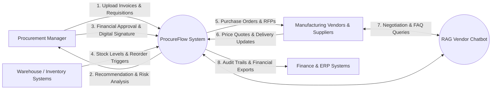
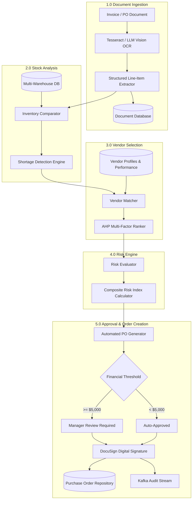

# Data Flow Diagrams (DFD)

Data Flow Diagrams depict how data travels through the ProcureFlow platform, detailing input sources, processing checkpoints, persistent datastores, and generated system outputs.

---

## 📈 Complete System DFD

The following diagram illustrates the multi-stage data flow across external actors, specialized agents, datastores, and approval entities:

{: .doc-image }

---

## 🌐 Level 0: Context Diagram

The Context Diagram defines the system boundary and identifies external entities that interact with ProcureFlow.

### External Entities

1. **Procurement Manager / Approvers:** Uploads source procurement requests, reviews agent recommendations, and executes legal/financial authorizations.
2. **Warehouse / Inventory Systems:** Streams inventory updates, consumption logs, and bills of materials (BOMs).
3. **Vendors & Suppliers:** Receives purchase orders, submits quotations, and interacts with the automated vendor chatbot.
4. **Finance & ERP:** Consumes finalized purchase orders, 3-way matching records, and compliance audit logs.

---

## 🔍 Level 1: Process Decomposition

Level 1 breaks down the primary data processing operations across the multi-agent system:

| Process ID | Process Name | Primary Data Inputs | Primary Data Outputs | Interacting Agents |
| :--- | :--- | :--- | :--- | :--- |
| **1.0** | **Document Intelligence & Ingestion** | Raw PDF invoices, scanned POs, image files | Normalized JSON line items, supplier metadata, tax totals | Document OCR Agent |
| **2.0** | **Inventory Deficit Assessment** | Requisition line items, warehouse stock tables | Net deficit quantities, urgency priority | Inventory Analysis Agent |
| **3.0** | **Vendor Scoring & Matching** | Item specifications, vendor historical logs | Ranked vendor matrix, price/quality weights | Vendor Evaluation Agent |
| **4.0** | **Procurement Risk Analysis** | Vendor scorecards, market volatility indices | Composite risk score, anomaly warnings | Risk Assessment Agent |
| **5.0** | **Tiered Governance & Approval** | Draft POs, managerial credentials | Signed PO, DocuSign envelope, audit log | Approval Coordinator Agent |
| **6.0** | **Interactive Vendor Support** | Natural language vendor queries | RAG contextual answers, PO status updates | RAG Chatbot Agent |

---

## 🔄 Detailed Process Breakdown (Level 2)

