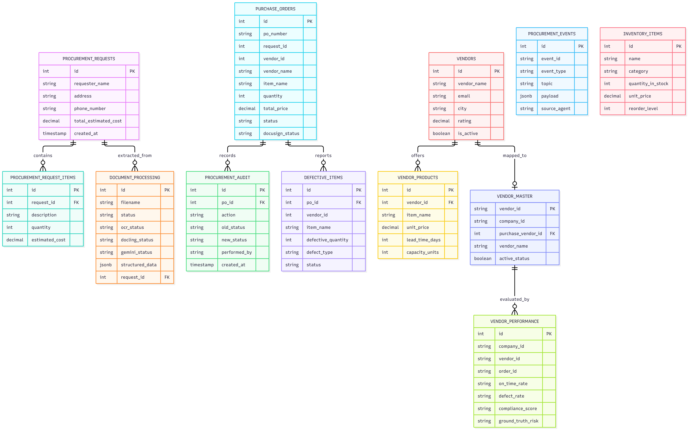
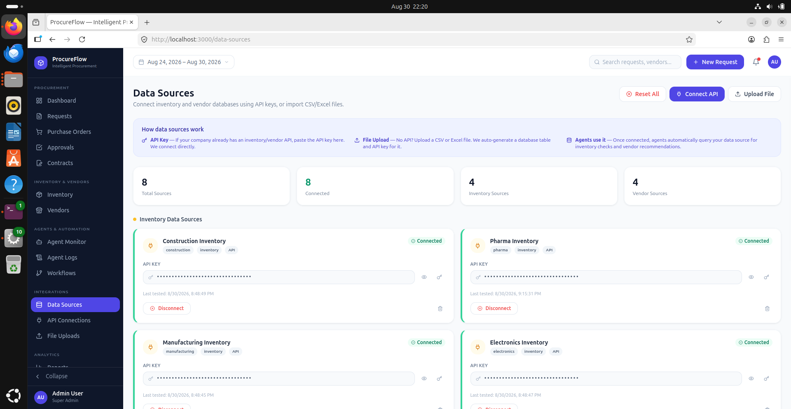
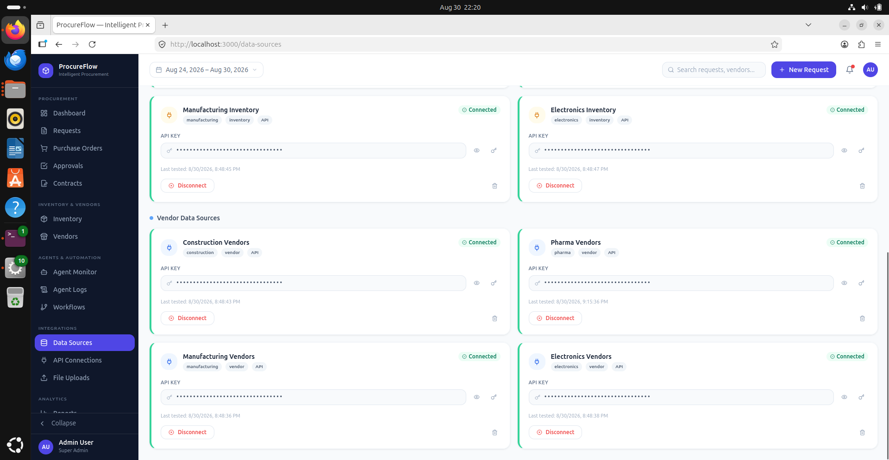
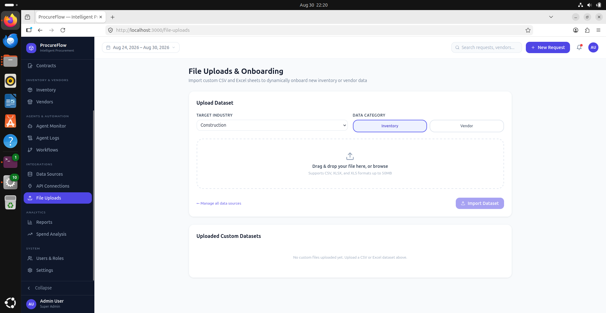
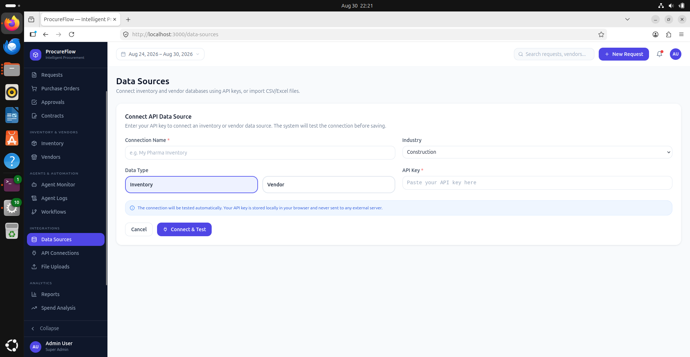

# Database Architecture & Entity-Relationship (ER) Diagram

ProcureFlow employs a robust relational schema in **PostgreSQL** coupled with **MinIO** object storage for unstructured document payloads (PDF invoices, scanned POs, and digital signature envelopes).

---

## 📊 Entity–Relationship Diagram

The core business entities and their relational constraints are mapped below:

{: .doc-image }

---

## 🗄️ Relational Schema Breakdown

### 1. Document & Ingestion Models
- **`documents`**: Tracks raw uploaded files, file sizes, MIME types, and MinIO storage URIs.
- **`extracted_line_items`**: Contains items parsed by the OCR and Document Intelligence agent. Includes extracted product name, SKU, unit count, price, tax breakdown, and parsing confidence score.

### 2. Multi-Warehouse Inventory Models
- **`warehouses`**: Manufacturing facilities and storage depot locations.
- **`inventory_items`**: Current physical stock, reorder point (ROP), safety stock limits, and active allocation counts.
- **`stock_movements`**: Complete ledger of inward material receipts, production issues, and return dispatches.

### 3. Vendor Master & Performance Scoring
- **`vendors`**: Supplier profile, contact person, payment terms, and active operational status.
- **`vendor_performance`**: Aggregated performance metrics including historical on-time delivery rate, quality compliance percentage, defect count, and average fulfillment lead time.
- **`vendor_catalogs`**: Approved pricing tables and lead time matrices per SKU.

### 4. Purchase Order & Financial Governance
- **`purchase_orders`**: Purchase order state machine (Draft, In Review, Approved, Dispatched, Fulfilled, Cancelled). Tracks total valuation, currency, targeted supplier, and approval tier.
- **`po_line_items`**: Granular itemized specifications, negotiated unit rates, and quantity breakdowns.
- **`approval_records`**: Immutable audit logs of managerial approvals, digital signatures, DocuSign envelope IDs, and cryptographic timestamps.

---

## 🔌 Data Source Integrations & API Connectors

ProcureFlow supports dynamic database connectors and external API integrations, allowing manufacturing enterprises to ingest live ERP inventories and vendor catalogs without manual data exports.

### Multi-Database Connectors
{: .doc-image }
{: .doc-image }

### Uploading External Database Snapshots
Users can directly connect API endpoints or upload structured CSV/SQL database dumps to hydrate initial inventory baselines and vendor catalogs.

{: .doc-image }
{: .doc-image }

---

## 🛡️ ACID Guarantees & Audit Integrity

1. **Transactional Safety:** Critical purchase order state transitions utilize atomic database transactions. If an approval fails or DocuSign webhook throws a communication error, the state automatically rolls back.
2. **Kafka Event Sync:** Every database mutation emits a change-data-capture event into Apache Kafka, ensuring downstream reporting microservices and audit logs remain synchronized in real time.
