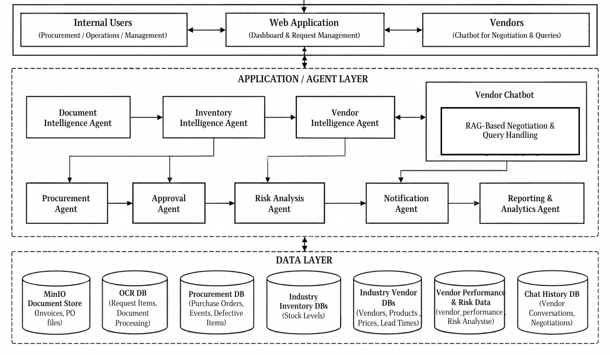
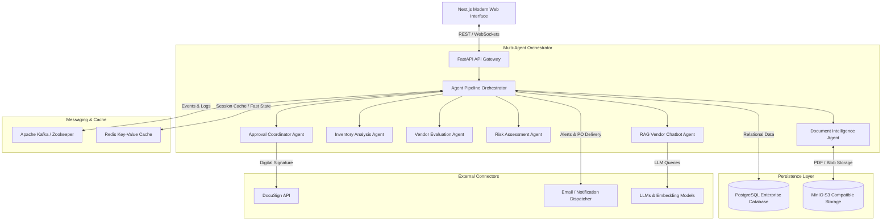
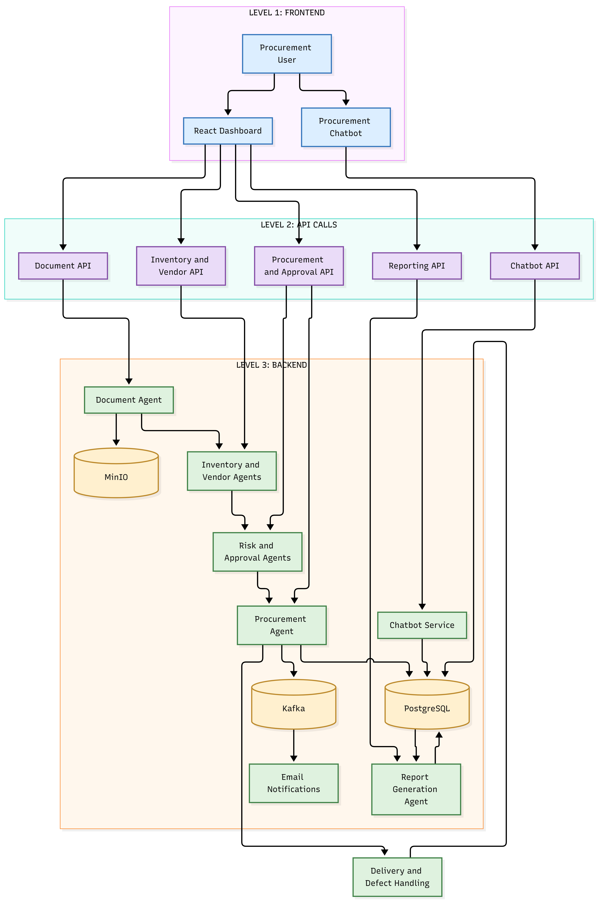
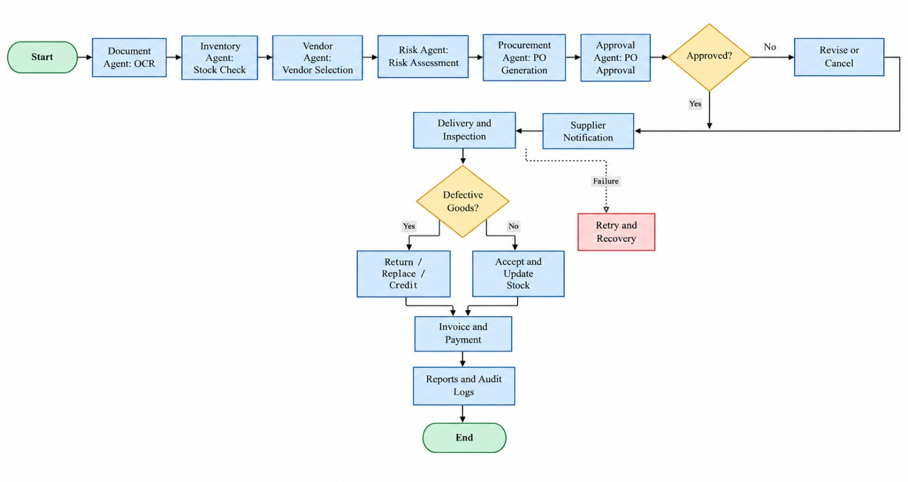

# System Architecture & Technical Topology

ProcureFlow is built on an enterprise-grade, event-driven microservices architecture that separates presentation, agent orchestration, asynchronous task processing, data storage, and external integrations.

---

## 🏛️ High-Level Architectural Diagram

{: .doc-image }

The platform is designed around loose coupling, allowing individual agents to execute independently or collaborate via an event bus. The system guarantees that heavy AI inference tasks (e.g., document parsing or multi-vendor scoring) do not block the user interface.

---

## ⚙️ Core Technology Stack

The system utilizes an enterprise stack tested for high throughput, data consistency, and low latency:

| Layer | Technologies Selected | Justification & Purpose |
| :--- | :--- | :--- |
| **Frontend UI** | **Next.js 14, React 18, Tailwind CSS, Lucide Icons** | High-performance server-side rendering, responsive responsive dashboard, real-time status indicators. |
| **Backend Services** | **Python 3.10+, FastAPI, Pydantic, Uvicorn** | Asynchronous I/O, strict type validation, automated OpenAPI documentation generation. |
| **AI / Agentic Framework** | **LangChain, OpenAI GPT-4 / Anthropic Claude, FAISS Vector Store** | Flexible agent tool-calling, chain-of-thought evaluation, Retrieval-Augmented Generation (RAG). |
| **Message Streaming** | **Apache Kafka & Zookeeper** | Asynchronous event streaming, distributed auditing, fault-tolerant message logging between microservices. |
| **Relational Database** | **PostgreSQL 15** | ACID transactional integrity, relational schema for POs, line items, and multi-tier approval logs. |
| **In-Memory Cache** | **Redis 7** | Caching active agent sessions, fast key-value lookups, rate limiting, and pub/sub messaging. |
| **Object Storage** | **MinIO (S3-compatible)** | High-throughput object storage for invoices, vendor contracts, signed POs, and generated reports. |
| **Containerization** | **Docker & Docker Compose** | Reproducible multi-service deployment, isolated networking, environment portability. |

---

## 🔄 End-to-End Execution Flow

{: .doc-image }

When a procurement trigger occurs (either by manual document upload or automated low-stock detection), execution traverses through coordinated agent stages:

```mermaid
sequenceDiagram
    autonumber
    actor Manager as Procurement Manager
    participant UI as Next.js Web UI
    participant GW as FastAPI Gateway
    participant Orchestrator as Multi-Agent Core
    participant Kafka as Apache Kafka
    participant DB as PostgreSQL
    participant DocuSign as DocuSign Integration

    Manager->>UI: Uploads Requisition / Invoice Document
    UI->>GW: POST /api/documents/upload
    GW->>Orchestrator: Ingest document into pipeline
    Orchestrator->>Kafka: Publish "DOCUMENT_UPLOADED" event
    
    rect rgb(30, 41, 59)
        Note over Orchestrator: OCR Agent parses tables & line items
        Note over Orchestrator: Inventory Agent detects stock deficit
        Note over Orchestrator: Vendor Agent ranks top 3 suppliers
        Note over Orchestrator: Risk Agent evaluates price variance & lead time
    end

    Orchestrator->>DB: Persist Draft Purchase Order & Recommendation
    Orchestrator->>Kafka: Publish "PO_AWAITING_APPROVAL" event
    UI->>Manager: Displays Actionable Approval Hub with Rationale
    Manager->>UI: Approves Order with Digital Signature
    UI->>DocuSign: Verify & Sign Final PO Document
    DocuSign-->>GW: Webhook "PO_EXECUTED"
    GW->>Kafka: Publish "PO_DISPATCHED"
    GW-->>Manager: Instant Confirmation & Audit Trail Updated
```

---

## 📊 System Execution Monitoring

{: .doc-image }

Every transaction produces real-time event logs delivered across Kafka topics. This provides complete visibility into:
1. Agent decision latency and execution duration.
2. Confidence scores and reasoning rationales for vendor selection.
3. Strict audit trails of who authorized financial expenditures.
