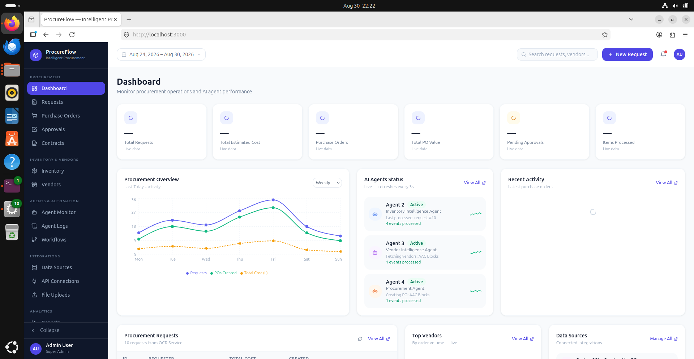

# Agentic AI for Smart Procurement in Manufacturing Industries

  Status: Production Ready
  Architecture: Multi-Agent Microservices
  Framework: Next.js + FastAPI + Kafka
  Human-In-The-Loop: Enabled

Welcome to the centralized technical documentation for **ProcureFlow**, an autonomous multi-agent procurement platform designed specifically for manufacturing industries.

{: .doc-image }

---

## 📌 Executive Summary

Manufacturing procurement involves document processing, inventory assessment, vendor selection, purchase-order generation, approvals, and risk analysis. Traditional manual and rule-based approaches render these activities time-consuming, siloed, and prone to costly delays.

**ProcureFlow** provides an intelligent, AI-driven procurement management solution using a modular multi-agent architecture. Specialized agents coordinate document intelligence (OCR), real-time inventory gap detection, multi-attribute vendor evaluation, automated purchase order generation, risk mitigation, and digital signatures—while retaining **strict human oversight for financial approvals and contract execution**.

---

## 👥 Project Information & Authorship

This project is submitted in partial fulfilment of the requirements of the **University of Mumbai** for the Degree of **Bachelor of Engineering in Computer Engineering** at **Fr. Conceicao Rodrigues Institute of Technology (FCRIT), Vashi, Navi Mumbai** (Academic Year 2026–2027).

### 👨‍💻 Project Group Members

| Roll No. / Exam Seat No. | Student Name | Role / Focus Areas |
| :--- | :--- | :--- |
| **1023262** | **Kaustubh Waje** | Multi-Agent Orchestration & Backend Infrastructure |
| **5023155** | **Ishwari Shinde** | Machine Learning, OCR & Document Intelligence |
| **5023139** | **Dikshant Phulpagar** | Database Engineering, Kafka Pipelines & Data Ingestion |
| **5023113** | **Ashley Fernandes** | Frontend Architecture (Next.js/React) & UI/UX Integration |

### 🎓 Project Supervisors & Mentors

- **Internal Supervisor:** Mrs. Nupur Gaikwad (*Department of Computer Engineering, FCRIT Vashi*), Mrs. Poonam Bari (*Department of Information Technology, FCRIT Vashi*)
- **External Supervisor:** Mr. Alok Chilka (*Industry Specialist*)

---

## 🚀 Key System Capabilities

-   :material-file-document-check:{ .lg .middle } __Document Intelligence & OCR__

    ---

    Automated invoice, PO, and requisition ingestion using advanced Optical Character Recognition and LLM parsing to extract structured line items without manual data entry.

-   :material-warehouse:{ .lg .middle } __Inventory Analysis & Shortage Detection__

    ---

    Monitors enterprise stock across multiple warehouse databases to identify real-time shortages against reorder thresholds and bills of materials.

-   :material-account-star:{ .lg .middle } __Multi-Attribute Vendor Scoring__

    ---

    Dynamically ranks suppliers using historical delivery accuracy, quality ratings, unit pricing, compliance scores, and real-time reliability metrics.

-   :material-shield-alert:{ .lg .middle } __Proactive Risk Assessment__

    ---

    Evaluates market price volatility, single-supplier concentration risk, lead-time variance, and geopolitical risk factors before placing orders.

-   :material-draw-pen:{ .lg .middle } __Tiered Approvals & DocuSign Integration__

    ---

    Automated routing of requisitions based on enterprise financial authority thresholds, coupled with cryptographic digital signatures and DocuSign verification.

-   :material-robot:{ .lg .middle } __RAG-Powered Vendor Chatbot__

    ---

    LLM-powered conversational interface that allows suppliers to query order status, clarify delivery schedules, and conduct automated RFP negotiations.

---

## 🧭 Documentation Navigation

Explore the technical chapters through the top navigation bar or the links below:

1. [**System Architecture**](architecture/overview.md) – Microservices topology, event-driven streaming with Kafka, and containerized deployment.
2. [**Data Flow Diagrams (DFD)**](architecture/dfd.md) – Context (Level 0) and detailed (Level 1 & 2) data flow diagrams.
3. [**Database & ER Diagram**](architecture/er-diagram.md) – Relational entity-relationship design, multi-tenant databases, and MinIO storage.
4. [**Procurement Lifecycle**](workflows/procurement-lifecycle.md) – Step-by-step requisition, analysis, ordering, and audit tracking.
5. [**Document Processing**](workflows/document-processing.md) – Ingestion pipelines, OCR extraction, and 3-way matching.
6. [**Approvals & Signatures**](workflows/approval-and-signatures.md) – Governance matrices, digital signature verification, and DocuSign flows.
7. [**AI Agents Ecosystem**](agents/overview.md) – Orchestration patterns, inter-agent messaging, and memory models.
8. [**Agent Specifications**](agents/agent-specs.md) – Deep dive into individual agent prompts, toolkits, inputs, and outputs.
9. [**REST APIs**](apis/endpoints.md) – Microservices endpoints, payload schemas, and response formats.
10. [**Configuration**](configuration/environment.md) – Environment variables, LLM provider integration, and database credentials.
11. [**Deployment**](deployment/docker-compose.md) – Docker Compose multi-container orchestrator setup and health checking.
12. [**Testing**](testing/test-cases.md) – Comprehensive test case matrix, integration verification, and results.
13. [**Troubleshooting & FAQs**](troubleshooting/faqs.md) – Diagnostic guides, common port conflicts, and disaster recovery procedures.
