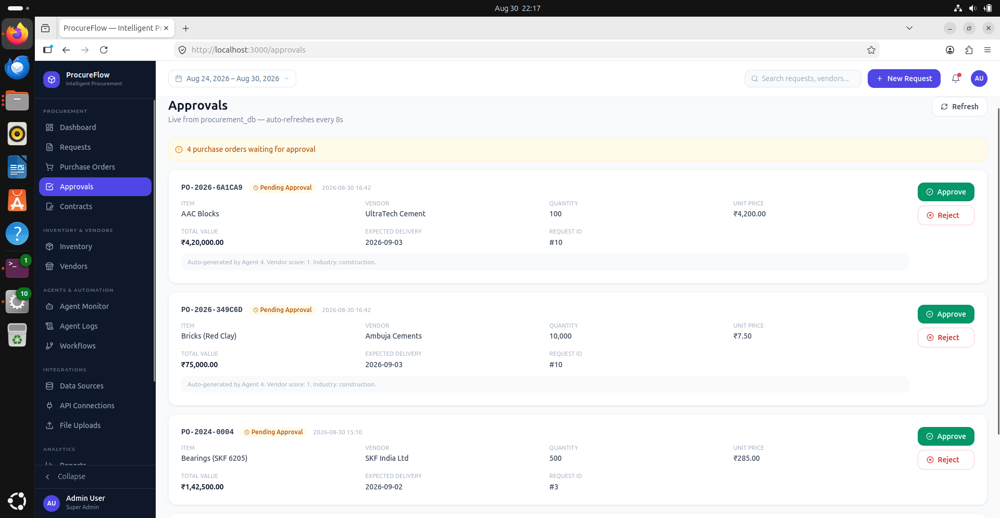
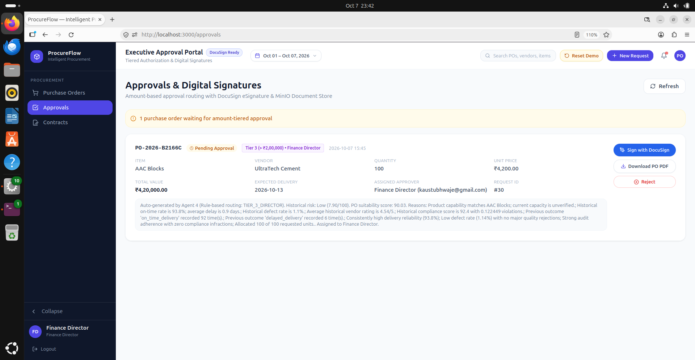
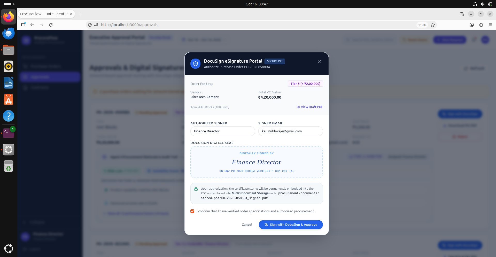
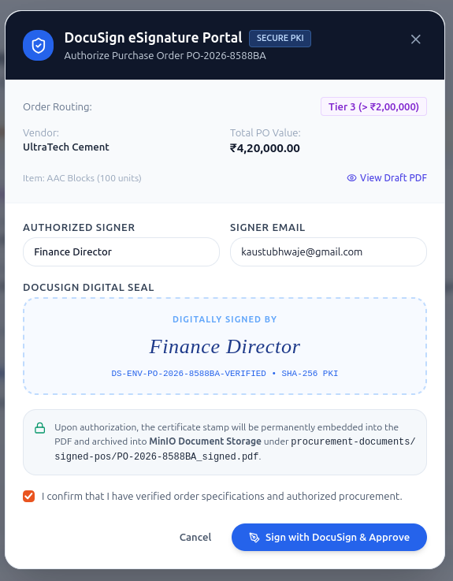

# Approvals, Governance & Digital Signatures

ProcureFlow enforces enterprise-grade financial governance through **role-based approval hierarchies** and **DocuSign digital signature integrations**, guaranteeing that AI agents never dispatch funds or enter contracts autonomously without authorized human sign-off.

---

## 🏛️ Financial Approval Hierarchy

Every generated purchase order is evaluated against the organization's financial authority matrix:

| Threshold Tier | Order Value | Required Approver Role | Approval Mechanism |
| :--- | :--- | :--- | :--- |
| **Tier 1 (Operational)** | `< $5,000` | Procurement Specialist / Supervisor | Single-click dashboard authorization |
| **Tier 2 (Managerial)** | `$5,000 – $25,000` | Department Head / Plant Manager | Dashboard approval + Password confirmation |
| **Tier 3 (Executive)** | `> $25,000` | Director / Chief Financial Officer (CFO) | Two-factor authorization + DocuSign Digital Signature |

---

## 🎯 The Approval Hub & Recommendation Rationale

The Approval Hub provides approvers with full transparency into *why* a specific vendor and order quantity were selected:

{: .doc-image }

Approvers can expand the **Agent Decision Rationale** to review:
1. Vendor scoring breakdown (price vs. quality vs. lead time).
2. Alternative vendors evaluated and why they were rejected.
3. Market risk index and lead-time volatility forecasts.

{: .doc-image }

---

## ✍️ DocuSign & Cryptographic Signatures

Once an executive approves an order, ProcureFlow automatically generates the legal PO contract and creates an envelope via the **DocuSign eSignature API**:

{: .doc-image }
{: .doc-image }

### Digital Signature Security Properties
- **Cryptographic Hashing:** The document content is hashed using `SHA-256` prior to signature transmission.
- **Envelope Tracking:** Real-time webhooks listen for `envelope-signed` and `envelope-completed` events.
- **Tamper Evidence:** Once signed, any modification to the PO invalidates the certificate, preventing unauthorized modifications.
- **Audit Retention:** The signed PDF and certificate of completion are stored securely in MinIO with links recorded in PostgreSQL.
