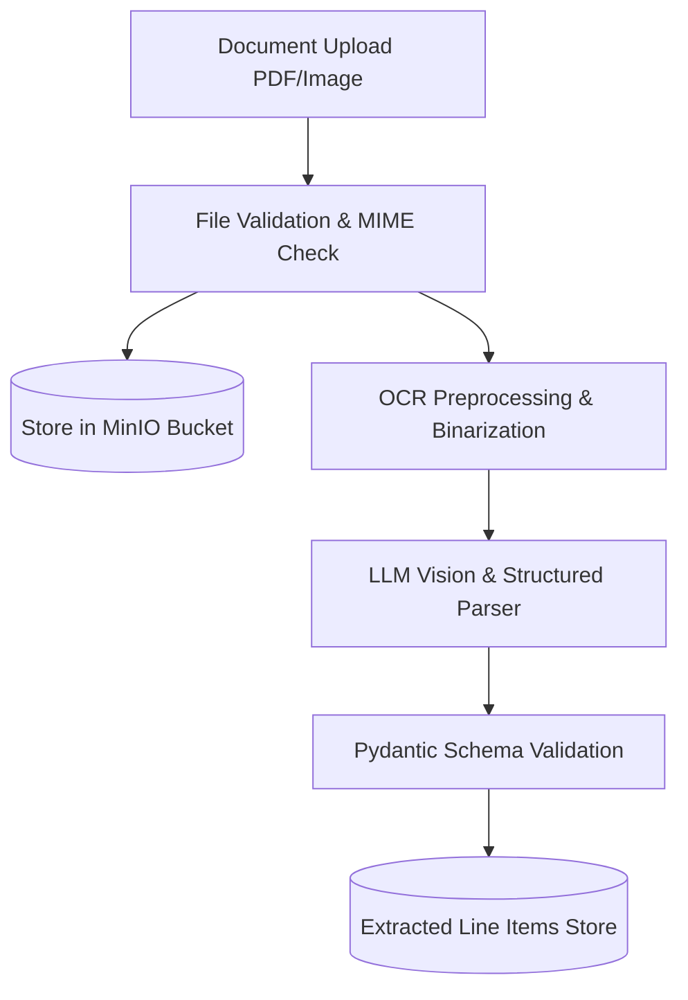
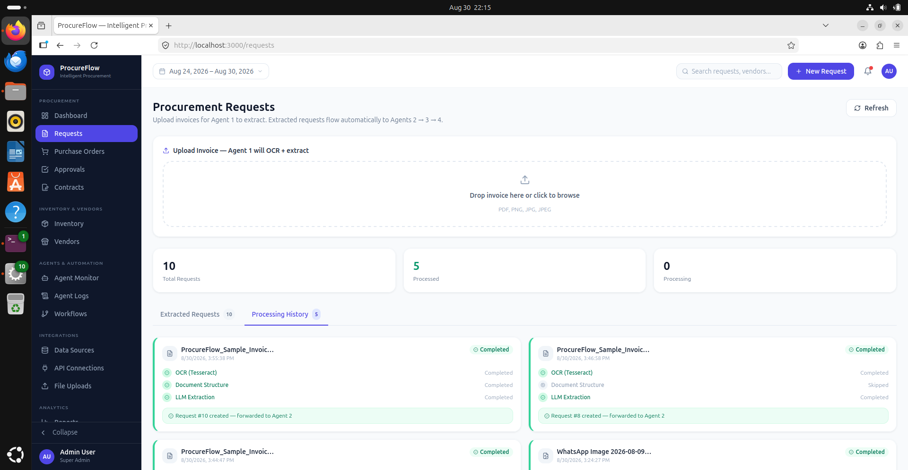
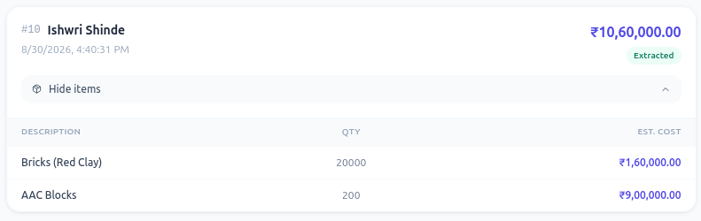

# Document Intelligence & Optical Character Recognition (OCR)

In manufacturing procurement, documents such as vendor invoices, quotes, and bills of materials arrive in diverse, unstructured formats (scanned PDFs, PNG/JPEG receipts, and legacy spreadsheets). 

The **Document Intelligence Agent** eliminates manual data entry by extracting, validating, and structuring line items into standardized JSON payloads.

---

## 📄 Ingestion Pipeline



---

## 🖥️ User Upload Interface

The system supports drag-and-drop document upload with real-time feedback:

{: .doc-image }

Once processed, the agent displays a comprehensive line-item summary with confidence indicators for each extracted field:

{: .doc-image }

---

## 🔍 Structured Extraction Schema

Extracted data is normalized into strict Pydantic models:

```python
from pydantic import BaseModel, Field
from typing import List, Optional

class ExtractedLineItem(BaseModel):
    item_description: str = Field(description="Name or description of raw material/component")
    part_number: Optional[str] = Field(description="Manufacturer SKU or internal part code")
    quantity: float = Field(description="Quantity requested or invoiced")
    unit_of_measure: str = Field(description="Units (e.g., pcs, kg, meters, liters)")
    unit_price: float = Field(description="Quoted price per unit")
    total_amount: float = Field(description="Calculated total price for line item")
    confidence_score: float = Field(ge=0.0, le=1.0, description="OCR extraction certainty")

class ParsedDocumentResponse(BaseModel):
    document_id: str
    vendor_name: Optional[str]
    invoice_date: Optional[str]
    currency: str = "USD"
    subtotal: float
    tax_amount: float
    total_amount: float
    line_items: List[ExtractedLineItem]
```

---

## 🛡️ Error Handling & Fallbacks

- **Low-Confidence Flags:** Any field extracted with a confidence score below **0.80** is highlighted in yellow for manual verification.
- **Mathematical Reconciliation:** The agent validates that $\sum (\text{Quantity} \times \text{Unit Price}) + \text{Tax} = \text{Total Amount}$. Any discrepancies trigger an instant mismatch alert before passing data to the downstream Inventory Agent.
