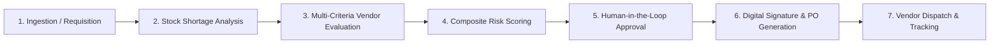
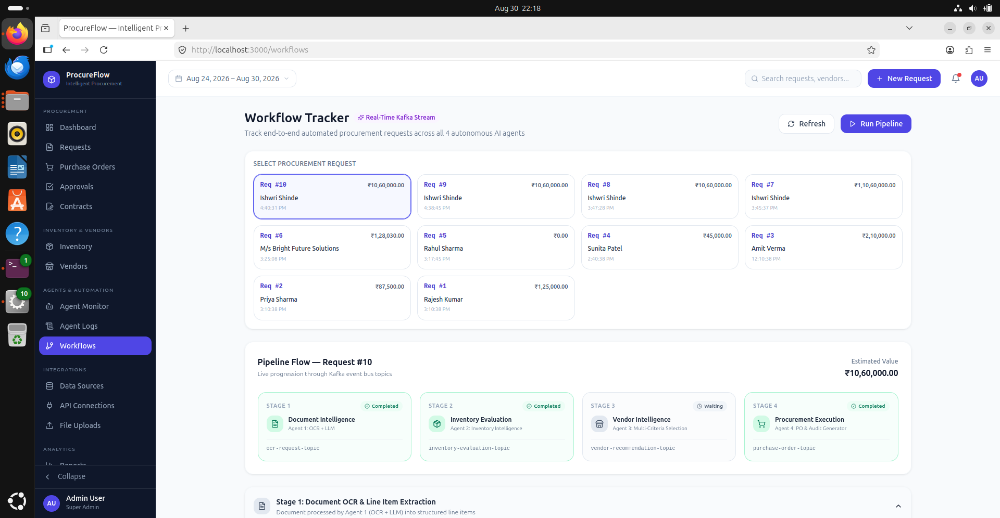
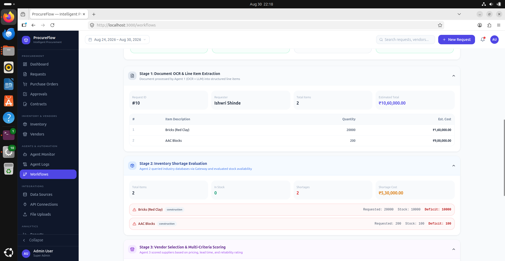
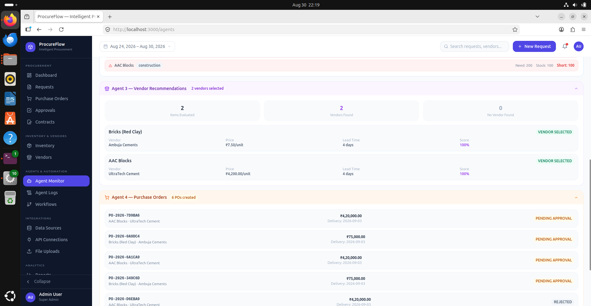

# End-to-End Procurement Lifecycle

ProcureFlow transforms the multi-step manufacturing procurement process into a seamless, autonomous, and auditable pipeline.

---

## 🔄 End-to-End Workflow Stages

### 1. Ingestion & Trigger
- A user uploads a requisition file, bill of materials (BOM), or invoice.
- Alternatively, automated database triggers flag items that drop below their Safety Stock limit.

### 2. Autonomous Deficit Analysis
- The **Inventory Analysis Agent** queries real-time stock across multiple warehouse databases.
- The agent calculates exact deficit quantities, lead times, and urgency classifications (e.g., *Critical*, *Standard*, *Low Priority*).

### 3. Dynamic Vendor Scoring & Evaluation
- The **Vendor Evaluation Agent** calculates a composite score for qualified suppliers based on:
  - Unit Price competitiveness
  - Historical delivery punctuality
  - Defect and return rate
  - ESG and compliance certifications

### 4. Risk Mitigation & Sanity Checks
- The **Risk Assessment Agent** examines market price fluctuations, geopolitical supplier dependencies, and delivery reliability.
- Recommendations are accompanied by clear reasoning rationales.

### 5. Tiered Managerial Approval
- Orders passing all automated checks are routed according to predefined financial thresholds.
- Managers review the consolidated dashboard and approve or reject with single-click actions.

### 6. PO Execution & Signature
- Upon approval, the system generates an official PDF Purchase Order with an immutable cryptographic hash.
- Integrates directly with DocuSign for legally binding digital signatures.

---

## ⏱️ Real-Time Workflow Tracking

ProcureFlow features a dedicated **Workflow Tracker** providing real-time visibility into the lifecycle of every requisition and agent execution state.

### Stage 1: Pipeline Ingestion & Initial Parsing
{: .doc-image }

### Stage 2: Vendor Matching & Risk Calculation
{: .doc-image }

### Stage 3: Approval Execution & PO Dispatch
{: .doc-image }

---

## 📈 Operational Efficiency Gains

Compared to traditional manual manufacturing procurement:
- **Processing Time:** Reduced from 3–5 business days to under **4 minutes**.
- **Data Entry Errors:** Cut by **98%** through automated document OCR and schema validation.
- **Spend Optimization:** Up to **12% average cost savings** via dynamic multi-vendor price comparison.
